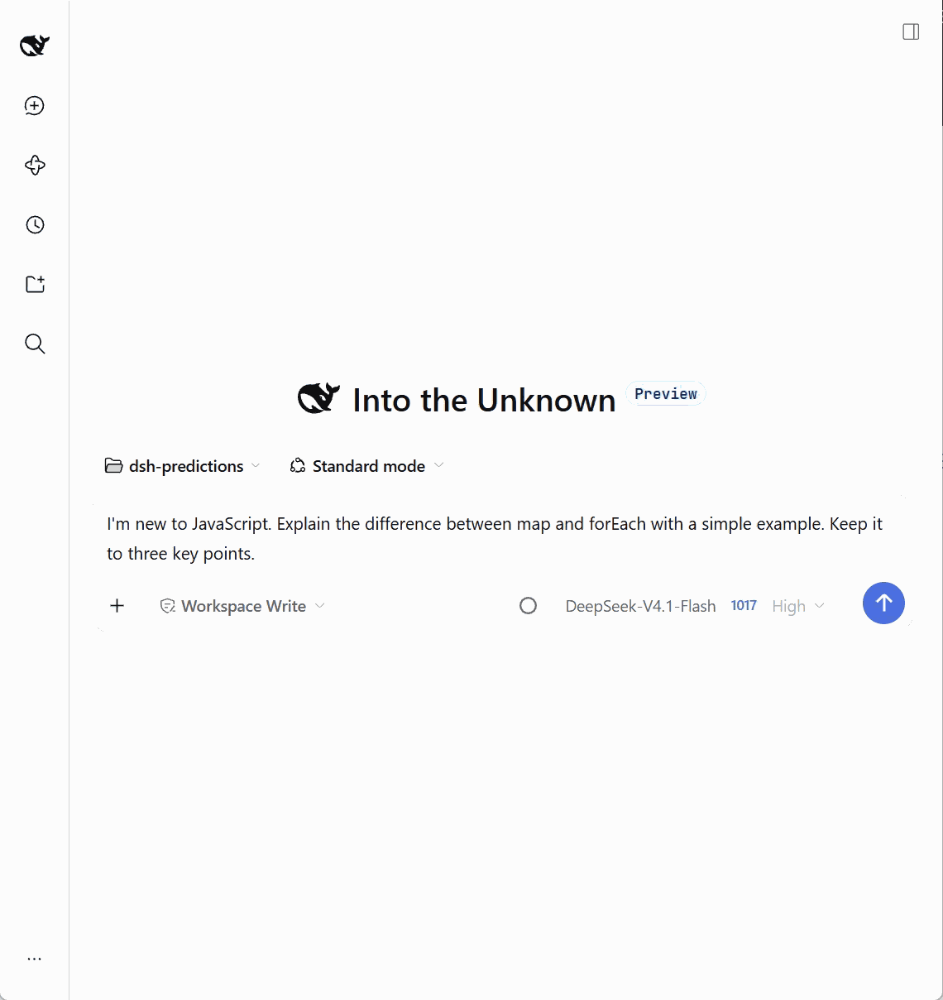

# DeepSeek Harness Predictions

[简体中文](./README.md) | English

**Predict your next message. Press Tab to fill it in. Send when you're ready.**

Inline suggestions for DeepSeek Harness (DSH). After the assistant replies, the plugin uses recent conversation context to suggest what you might say next. Accept it into your draft, review it, and decide whether to send.

`@kkucodes/dsh-predictions` · `1.0.0` · Independent plugin · No DSH modifications

[Get started](#get-started) · [Keyboard controls](#keyboard-controls) · [User guide](./docs/README.md) · [Changelog](./CHANGELOG.md) · [GitHub](https://github.com/KKUCODES/deepseek-harness-predictions) · [Report an issue](https://github.com/KKUCODES/deepseek-harness-predictions/issues)

## See it in action



## What it does

- **Keep the conversation moving.** Generate suggestions automatically, or switch to manual-only mode and press → twice quickly in an empty input.
- **Bring suggestions back.** Undo acceptance to an empty draft, or clear what you typed, to restore the cached suggestion without another model call.
- **Choose a prediction model separately.** Follow the conversation model, select a model configured in DSH, or use a custom OpenAI-compatible service. Your chat model stays the same.
- **See status and usage.** A status indicator sits beside the model selector. View this plugin's token usage and estimate costs using prices you enter.

Suggestions are available only in an empty input. Existing drafts, attachments, references, queued messages or a running conversation prevent prediction. The plugin does not overwrite your input, send messages automatically or start an Agent.

## Get started

### Compatibility

| Environment | Verification status |
| --- | --- |
| DSH Web `0.2.1-rc.3` · Edge | The 1.0.0 package passed the main installation and usage flow |
| DSH Web `0.2.1-rc.2` · Chrome | Additional runtime verification; see the [compatibility scope (Chinese)](./docs/project-knowledge/knowledge/domains/predictions/stability.md) |
| Standalone Electron desktop window | Not yet verified |

### 1. Install the plugin

Run this command in a terminal to install directly into DSH Web:

```sh
dsh plugin --profile web add github:KKUCODES/deepseek-harness-predictions
```

Alternatively, open **插件 → 添加插件** (Plugins → Add plugin) in the DSH sidebar, enter `github:KKUCODES/deepseek-harness-predictions`, and install it. Make sure the plugin is enabled afterward.

The repository includes prebuilt files, so installation requires no local build or additional build approval. Offline packages and release notes are available from [Releases](https://github.com/KKUCODES/deepseek-harness-predictions/releases).

<details>
<summary>Have the source? Build the package locally</summary>

Use Node.js 24.9 or newer. Run these commands from the project root:

```sh
npm ci --ignore-scripts
npm run build
node -e "require('node:fs').mkdirSync('artifacts', { recursive: true })"
npm pack --ignore-scripts --pack-destination artifacts
```

The result is `artifacts/kkucodes-dsh-predictions-1.0.0.tgz`. Build before packaging; a source folder or arbitrary open-source repository is not automatically an installable DSH plugin. See the [development guide (Chinese)](./docs/development.md).

</details>

### 2. Enable predictions

1. Open the settings for `@kkucodes/dsh-predictions` and enable **启用预测消息** (Enable predictions).
2. Open a conversation with at least one normally completed assistant reply. Wait for a suggestion, or press → twice quickly in an empty input.
3. Press Tab to fill the draft, review it, then send it yourself.

**Real predictions are off by default. Enabling them may incur model-provider charges.** To try the interaction first, use **更多设置 → 效果测试** (More settings → Effect test). It displays fixed text without calling a model and pauses real prediction while enabled.

## Keyboard controls

| Action | Result |
| --- | --- |
| Tab in an empty input | Fill the draft with the existing suggestion immediately |
| Press → once in an empty input | Accept the existing suggestion after roughly 300 ms |
| Press → twice quickly in an empty input | Generate once if no suggestion exists |
| Undo to an empty draft, or clear the text | Restore the cached suggestion without another request |
| Esc | Dismiss the suggestion for this turn |

Pressing → twice keeps an existing suggestion rather than regenerating it. With a nonempty draft, normal cursor behavior is preserved. A new empty conversation has no context to predict from.

## Your choice of model

Predictions follow the current conversation model by default, or you can choose a separate model. Custom connections support **non-streaming OpenAI Chat Completions-compatible APIs**, with a base URL, API key, model ID, optional output limit, and string, number, boolean or JSON parameters.

Custom keys are stored through DSH's public credentials service, not ordinary plugin settings. Saved keys are not displayed. Connection testing sends one request; a successful test still requires **保存并使用** (Save and use). See [model configuration (Chinese)](./docs/README.md#选择预测模型).

## Costs and privacy

Your selected provider charges for prediction and connection-test requests. The plugin has no daily call limit; turn it off or choose manual-only mode when appropriate. Accepting, undoing, restoring or reading a cached suggestion does not trigger another model call.

Usage statistics cover this plugin only. Cost estimates use prices you enter; your provider's bill is authoritative. Requests without complete usage information are marked for reconciliation, not treated as free.

By default, prediction uses up to **8 recent user/assistant text messages**, sent to your selected model service. Conversation system instructions, tool logs, attachments and reasoning content are excluded. [Context and privacy details (Chinese)](./docs/README.md#对话内容与隐私)

## Known limits

- Requests time out after **12 seconds** and are not retried automatically. Check the status details before explicitly retrying.
- Immediately after a local command, the first accepted suggestion may not support Ctrl+Z undo; select and delete it if needed.
- Real system IME candidate windows, Electron and cross-device real-time synchronization are not fully verified.

See [troubleshooting (Chinese)](./docs/README.md#常见问题) for more.

## Documentation and development

- [User guide (Chinese)](./docs/README.md): generation modes, model settings, typed parameters, usage and troubleshooting.
- [Changelog (Chinese)](./CHANGELOG.md): version changes.
- [Development guide (Chinese)](./docs/development.md): build and verification commands.
- [Project knowledge base (Chinese)](./docs/project-knowledge/catalog.md): interfaces, design and verified scope.
