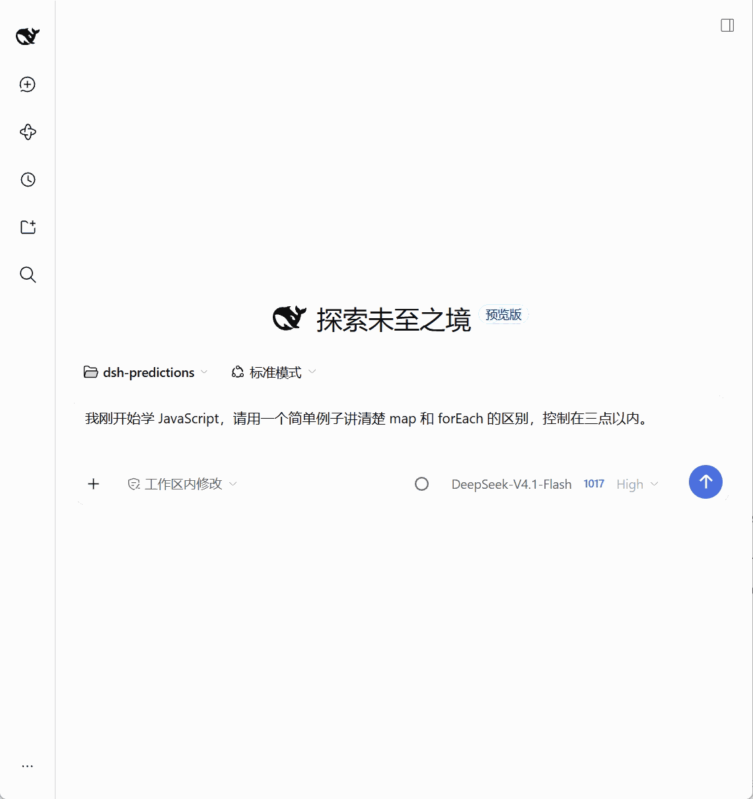

# DeepSeek Harness Predictions

简体中文 | [English](./README.en.md)

**预测你的下一句话，Tab 填入，确认后发送。**

为 DeepSeek Harness（DSH）提供输入框灰字建议。助手回复后，插件根据近期对话预测你可能说的下一句话；需要时按一下填入草稿，发送仍由你决定。

`@kkucodes/dsh-predictions` · `1.0.0` · 独立插件 · 不修改 DSH 本体

[开始使用](#开始使用) · [操作键位](#操作键位) · [完整指南](./docs/README.md) · [更新日志](./CHANGELOG.md) · [GitHub](https://github.com/KKUCODES/deepseek-harness-predictions) · [问题反馈](https://github.com/KKUCODES/deepseek-harness-predictions/issues)

## 看看效果



## 用起来是什么样

- **对话接着走**：自动生成下一句建议，也可切换为仅手动，在空输入框快速按两次 → 生成。
- **建议可以找回来**：接受后撤销至空草稿，或清空自己输入的文字，可恢复本轮建议，不重复调用模型。
- **预测模型独立选择**：跟随会话模型、选择宿主已配置的模型，或接入自定义 OpenAI 兼容服务，不改变主聊天模型。
- **状态和用量看得见**：模型选择旁显示预测状态；可查看本插件的 Token 用量，并按自填单价估算费用。

插件只在空输入框中提供建议。有草稿、附件、引用、排队消息或会话正在运行时会跳过，不覆盖你的输入，也不自动发送消息或启动 Agent。

## 开始使用

### 兼容范围

| 环境 | 当前验证情况 |
| --- | --- |
| DSH Web `0.2.1-rc.3` · Edge | 1.0.0 安装包主流程已验证 |
| DSH Web `0.2.1-rc.2` · Chrome | 补充运行验证，范围见[兼容性说明](./docs/project-knowledge/knowledge/domains/predictions/stability.md) |
| 独立 Electron 桌面窗口 | 尚未验收 |

### 1. 安装插件

在终端执行，直接安装到 DSH Web：

```sh
dsh plugin --profile web add github:KKUCODES/deepseek-harness-predictions
```

也可以在 DSH 侧边栏打开 **插件 → 添加插件**，填写 `github:KKUCODES/deepseek-harness-predictions` 并安装。安装后确认插件已启用。

仓库携带预编译产物，安装时无需本地构建或额外构建授权。离线安装包和版本说明见 [Releases](https://github.com/KKUCODES/deepseek-harness-predictions/releases)。

<details>
<summary>已有源码？在本地构建安装包</summary>

需要 Node.js 24.9 或更新版本。在本项目根目录执行：

```sh
npm ci --ignore-scripts
npm run build
node -e "require('node:fs').mkdirSync('artifacts', { recursive: true })"
npm pack --ignore-scripts --pack-destination artifacts
```

得到 `artifacts/kkucodes-dsh-predictions-1.0.0.tgz`。先构建再打包，不能直接把源码文件夹或任意开源仓库当作已构建插件安装。详细环境见[开发说明](./docs/development.md)。

</details>

### 2. 开启预测

1. 打开 `@kkucodes/dsh-predictions` 的设置，开启 **启用预测消息**。
2. 进入至少有一轮正常完成回复的会话，等待建议，或在空输入框快速按两次 →。
3. 按 Tab 填入草稿，检查内容后自行发送。

**真实预测默认关闭，开启后模型请求可能产生费用。** 想先体验操作，可在「更多设置 → 效果测试」使用固定测试句；效果测试不调用模型，开启时暂停真实预测。

## 操作键位

| 操作 | 效果 |
| --- | --- |
| 空输入框中按 Tab | 立即填入已有建议 |
| 空输入框中按一次 → | 约等待 300 毫秒后填入已有建议 |
| 空输入框中快速按两次 → | 没有建议时，手动生成一次 |
| 撤销至空草稿，或清空文字 | 恢复本轮缓存建议，不新增请求 |
| Esc | 丢弃本轮建议 |

已有建议时，按两次 → 会保留原建议，不重新生成；已有草稿时保持原光标操作。新建空会话尚无可预测的对话内容，不会生成建议。

## 模型由你选择

默认跟随当前会话，也可为预测单独选模型。自定义连接支持 **非流式 OpenAI Chat Completions 兼容格式**，可设置 API 基础地址、Key、模型名称，以及可选输出长度和文本、数字、布尔、JSON 参数。

自定义 Key 由 DSH 的公开凭据服务保存，不写入普通插件设置，界面不回显已存密钥。连接测试会发送一次请求，测试成功后仍需点击「保存并使用」。具体配置见[使用指南](./docs/README.md#选择预测模型)。

## 费用与隐私

预测及连接测试的模型费用由所选服务商收取。插件不设每日调用上限；不需要时关闭预测，或选择「仅手动」。接受、撤销、清空恢复和读取缓存不会新增模型调用。

统计仅包含本插件的调用，费用按自填单价估算，实际账单以服务商为准；没有完整用量的请求会标为待核对，不能当作免费。

默认最多使用近期 **8 条用户／助手文字**作为上下文，发送至你选择的模型服务。系统指令、工具日志、附件和思考过程不进入预测上下文。[上下文与隐私详情](./docs/README.md#对话内容与隐私)

## 使用前了解

- 请求超过 **12 秒**会超时，失败不自动重试；可查看状态提示，再明确手动重试。
- 刚执行本地命令的会话中，首次填入可能无法通过 Ctrl+Z 撤销，可选中后删除。
- 真实系统输入法候选词窗口、Electron 和跨设备实时同步尚未完整验收。

更多问题见[故障处理](./docs/README.md#常见问题)。

## 文档与开发

- [使用指南](./docs/README.md)：生成方式、模型配置、自定义参数、统计和常见问题。
- [更新日志](./CHANGELOG.md)：版本变化。
- [开发说明](./docs/development.md)：构建与验证命令。
- [项目知识库](./docs/project-knowledge/catalog.md)：接口、设计和实际验收范围。
